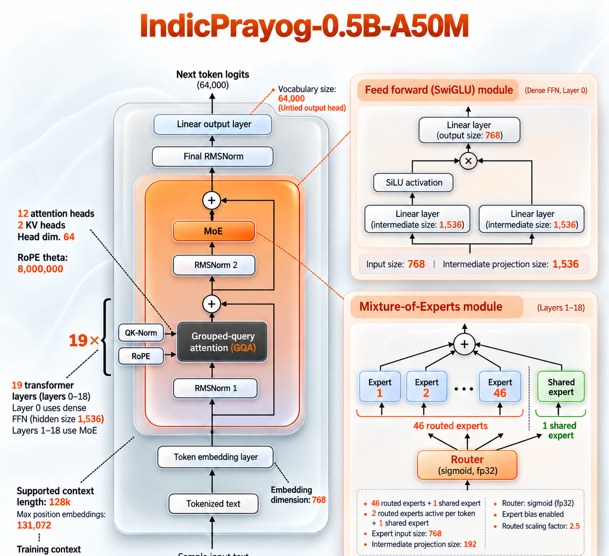
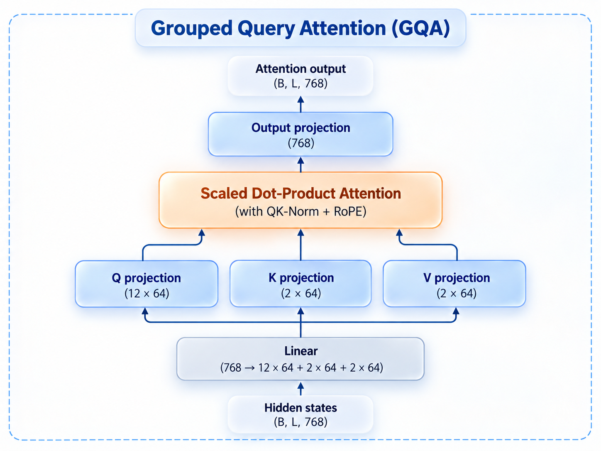
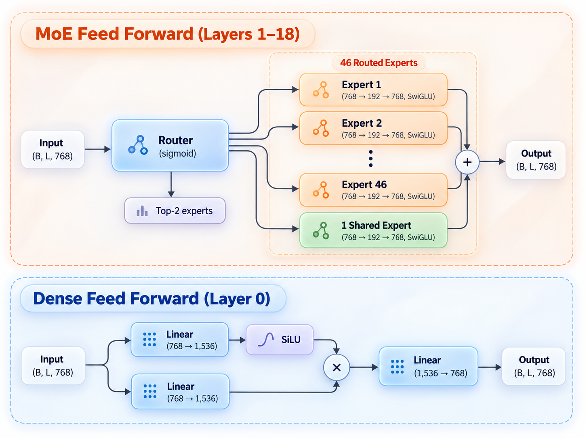

# IndicPrayog-0.5B-A50M

An open learning project to build and train a small Mixture of Experts language model for **Hindi, Marathi, and English**, from tokenizer to evaluation.

**The goal: understand how an Indic language model is built by building one ourselves.** We are targeting roughly 0.5 billion total parameters and approximately 50 million active parameters in the transformer core per token, with a training corpus of about 10 billion tokens.

The tokenizer and dataset preparation are complete, and the model architecture is implemented. Training and evaluation are the next stages.

## Why we are doing this

Using a language model leaves many decisions hidden: how text becomes tokens, how languages share a data budget, how experts receive tokens, and what makes training stable. IndicPrayog makes these decisions visible through code, experiments, and written explanations.

- **Learn the whole process.** Build the tokenizer, prepare the corpus, implement the model, train it, and measure what it learns.
- **Work with languages we care about.** Give Hindi and Marathi deliberate attention alongside English, including tokenizer efficiency and evaluation for each language.
- **Explore sparse computation at a manageable scale.** Study how a model can store many expert networks while using only a small subset for each token.
- **Make the work useful to other learners.** Keep the reasoning, measurements, and mistakes alongside the implementation so others can follow and reproduce the experiment.

## Learning from Sarvam-30B

[Sarvam-30B](https://huggingface.co/sarvamai/sarvam-30b) is the architectural reference for this experiment. We adapt its pattern of a leading dense feed forward layer followed by layers with routed and shared experts, together with grouped query attention. In a Mixture of Experts model, a router chooses which expert networks process each token; a shared expert processes every token.

Our approach is to implement these ideas at a smaller scale, use our own tokenizer and prepared corpus, and train newly initialized weights. The language scope is Hindi, Marathi, and English. The experiment will measure what this smaller design can learn within the chosen data budget.



*Architecture overview. The 128K label is a configured position limit; the planned pretraining sequences are 2,048 tokens long. Context-length performance remains to be evaluated.*

## How we scale it down

We retain the 19-layer depth and reduce the width of the networks. Using the dimensions in [Sarvam's published configuration](https://huggingface.co/sarvamai/sarvam-30b/blob/main/config.json), the width multiplier is:

```text
Width multiplier = 768 / 4096 = 3/16 = 0.1875

Hidden width:          4096 × 0.1875 = 768
Dense FFN width:       8192 × 0.1875 = 1536
Expert FFN width:      1024 × 0.1875 = 192
```

For a weight matrix whose two dimensions both shrink by this factor, the parameter count scales by `0.1875² ≈ 0.0352`. Vocabulary size and expert count have their own budgets, so the final model size comes from counting all components together.

Each SwiGLU expert has three weight matrices. This gives us a simple way to budget expert capacity:

```text
Parameters per expert = 3 × hidden width × expert FFN width
                      = 3 × 768 × 192
                      = 442,368

Stored expert weights = 18 layers × (46 routed + 1 shared) × 442,368
                      = 374,243,328 parameters
```

We choose 46 routed experts to bring the complete model, including attention, the dense layer, routers, embeddings, and output head, to **502.9M parameters**. Our custom 64K vocabulary keeps the embedding and output tables within that budget while focusing tokenizer capacity on the three target languages.

Each token uses two routed experts plus the shared expert in each expert layer. Counting those experts and the always-active transformer components gives **54.2M active parameters**. This is the approximate “A50M” in the name; it excludes the input embedding and output head. Including the output head brings that count to approximately **103.4M**.

The detailed configuration and full parameter accounting are in the [model guide](model/Readme.md).

<details>
<summary>Explore the attention and expert-routing diagrams</summary>

Grouped query attention lets groups of query heads share key and value heads.



The expert diagram contrasts the leading dense layer with the later sparse layers. For each token, only the selected routed experts and the shared expert contribute to the sparse layer's output.



</details>

## The plan and our progress

1. **Build the tokenizer: complete.** Compare tokenizer variants and select a vocabulary suited to Hindi, Marathi, and English.
2. **Prepare the data: complete.** Standardize Sangraha, Wikipedia, and FineWeb-Edu, sample a corpus of roughly 10B tokens, and create packed training data with separate validation sets. The target language mix is Hindi 40%, English 35%, and Marathi 25%.
3. **Implement and verify the model: architecture implemented.** Check the components and parameter budget, then finish training-readiness checks on the intended hardware.
4. **Pretrain from scratch: planned.** Establish a measured batch size and throughput, verify checkpoint recovery, and track loss and expert utilization throughout training.
5. **Evaluate: planned.** Measure held-out language modeling and text generation in all three languages, and report the results with their limitations.

## Repository structure

```text
IndicPrayog-0.5B-A50M/
├── .github/workflows/model-tests.yml      # Model correctness checks in CI
├── assets/                                # Architecture and component diagrams
├── IndicPrayog_tokenizer/
│   ├── scripts/                           # Training and comparison scripts
│   ├── tokenizers_out/                    # Saved tokenizer variants
│   └── baselines/                         # Reference tokenizers
├── dataset_preparation/
│   ├── dataset_lookup/                    # Explore data sources by language
│   └── dataset_complete_pipeline/         # Prepare the training corpus
│       ├── 1_format_standardize/          # Normalize source formats
│       ├── 2_lang_validation/             # Check document languages
│       ├── 3_train_and_val_split/         # Sample to the token budget
│       ├── 4_tokenization/                # Measure tokenization and token counts
│       └── 5_final_dataset/               # Pack training and validation rows
├── model/
│   ├── __init__.py                        # Public package imports
│   ├── config.py                          # Architecture settings and checks
│   ├── layers.py                          # Normalization, positions, attention, and FFNs
│   ├── moe.py                             # Expert routing, dispatch, and load balancing
│   ├── modeling.py                        # Decoder, loss, generation, and save/load
│   ├── parameter_count.py                 # Total and active parameter calculations
│   ├── smoke_test.py                      # Tiny and full model forward/backward checks
│   └── Readme.md                          # Model guide and usage
├── documentation/
│   ├── 1_tokenizer/full_overview.md       # Tokenizer design and results
│   └── 2_data_processing/full_overview.md # Dataset pipeline and measured totals
├── tests/                                 # Configuration and model correctness tests
├── requirements-model.txt                 # Model runtime dependency
├── ruff.toml                              # Python lint and formatting rules
├── LICENSE
└── README.md
```

To follow the project in order, start with the [tokenizer overview](documentation/1_tokenizer/full_overview.md), continue with the [data-processing overview](documentation/2_data_processing/full_overview.md), and then read the [model guide](model/Readme.md).

## License

See [LICENSE](LICENSE).
